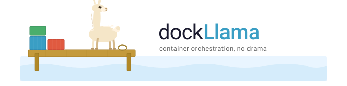

<p align="center"></p>

# DockLlama v2 (in development)

DockLlama watches your Docker containers and uses a local AI (Ollama) to explain, in plain words,
which ones need attention. **v2 is a rebuild** that sets everything up from the web page: no config
files, no group IDs to look up.

> v2 is not finished. The v1 code is kept under the [`v1-final`](../../tree/v1-final) tag.
> Progress follows the build phases in the v2 plan.

## What works so far (phases 1–10)

- One-command install with Docker Compose
- A setup guide in the browser: password, connect AI (or continue without it), pick a model
  (Quick start or test them all first), pick containers, set up notifications. No files to edit.
- First-run password setup and sign-in; change password in Settings
- Automatic Docker socket permissions (no `--group-add`)
- Settings → Containers: every container on this machine with its state in plain words, and a
  switch to choose which ones DockLlama watches
- Settings → AI: finds Ollama automatically (or type its address), suggests a model that fits your
  hardware, lets you pick any installed model, one-click downloads of suggested models, and an
  Advanced panel per model (thinking, context size, and more — only what that model supports)
- A dashboard: problems first as cards (plain status, what to do, the evidence behind it), everything
  else as small tiles; a page per container with history, CPU/memory, recent logs, Check now,
  Restart and "Tell DockLlama what's normal". Works on a phone.
- Notifications to ntfy (with a QR code to subscribe), Discord, Telegram, Gotify, Pushover, email or
  any Apprise URL: one message when a problem starts, one when it clears, optional "still broken"
  reminders, and one message if DockLlama itself can't check. Several at once come as one message.
- Optional automatic restarts for containers you allow, only when a restart would help (never crash
  loops, out-of-memory kills or stopped containers), with restart groups, a wait between restarts and
  a limit (3 an hour, then it asks you). Quiet hours hold restarts and messages. Starts in Watch only.
- A daily summary at the time you choose (local time): written by your AI, or a plain list without it.
- Optional: watch other Docker machines from the same dashboard. Settings → Machines → Add another
  machine gives you a compose file to run there (DockLlama Remote, same image, `dockllama remote`,
  port 8557, pairing token, restarts off unless you allow them; it never shares containers'
  environment variables).
- Checks every 10 minutes: Docker's own facts (crashes, restart loops, out-of-memory kills, failing
  health checks, stopped vs killed) plus, with AI, a plain-language read of the new log lines.
  Secrets in logs are masked before anything is stored or sent. Without AI, the Docker checks still run.
- Model testing on your own server: Test or Retest any model, or Test all (in the background, now
  while you watch, or tonight). One test at a time; results are kept per server and model version.
  When a background run finds a clearly better model, a banner suggests it on your next page —
  DockLlama never switches models by itself. New and downloaded models are tested automatically.

### Ollama on another computer

Ollama only listens on its own computer by default. On the Ollama machine set `OLLAMA_HOST=0.0.0.0`
and restart Ollama (Settings → AI shows the exact steps for Windows, Mac, Linux and Docker).
Ollama 0.9.0 or newer is required.

## Install

```bash
curl -O https://raw.githubusercontent.com/o51r15/DockLlama/v2/docker-compose.yml
docker compose up -d
```

Then open `http://<this machine's IP>:8556`. (On Linux, `hostname -I` shows the IP.)

Supported: Docker Engine on Linux, Docker Desktop (Windows/Mac), Unraid, Synology. Not supported
yet: Podman and rootless Docker.

**Keep DockLlama off the internet.** Access to the Docker socket means control of the machine.

### Using a folder instead of a Docker volume

If you change `dockllama-data:/app/data` to a folder like `./data:/app/data`, DockLlama makes that
folder owned by its own user (1000). To pick the owner yourself, set `PUID` and `PGID`, e.g. `99`
and `100` on Unraid.

## Forgot your password?

On the machine running DockLlama:

```bash
docker exec -it dockllama dockllama reset-password
```

## Development

```bash
pip install -r requirements-dev.txt
python -m pytest
```
